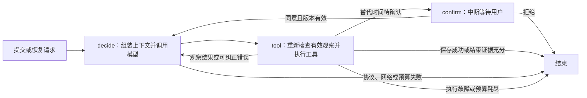

# 调用流程与实现取舍

## 技术选择与框架职责

保留单机CLI、三节点图和五个工具，避免把本题扩展成在线发布系统。
模型通过HTTPX独立适配层接入，业务状态放SQLite，LangGraph负责执行和恢复。

| 组件 | 验证版本 | 使用功能与职责 |
| --- | --- | --- |
| Python | 3.12.13 | 运行环境，SQLite使用标准库接口 |
| LangGraph | 1.2.18 | StateGraph、状态传递、路由、interrupt和Command恢复 |
| langgraph-checkpoint-sqlite | 3.1.2 | 持久化图检查点，重建应用后恢复原thread |
| Pydantic | 2.14.1 | 输入、业务数据和工具参数校验 |
| HTTPX | 0.28.1 | DeepSeek HTTPS请求及网络操作超时 |
| Typer | 0.27.3 | run、confirm、status、draft、trace命令和参数解析 |
| python-dotenv | 1.2.4 | 加载项目根目录.env，已有环境变量优先 |

版本依据[独立安装记录](../examples/test-results/hardening-20261030T231921/installed-versions.txt)，依赖以uv.lock为准。
DeepSeek默认模型名为`deepseek-flash`，关闭thinking。此前实际调用已验证工具调用能力，原始响应ID和usage保留在Trace。
本轮加固未新增依赖、修改数据库表结构或提高预算，也没有调用真实API。

参考：[DeepSeek工具调用](https://api-docs.deepseek.com/guides/tool_calls/)、
[LangGraph中断与恢复](https://docs.langchain.com/oss/python/langgraph/interrupts)。

## 调用流程与动态决策

实际节点只有`decide`、`tool`、`confirm`。上下文组装位于decide内部，不另建调度框架。
模型选择下一动作，程序执行工具并返回实际结果；业务错误可以让模型纠正，工具顺序没有写死。

五个工具分别是read_material、check_rules、query_slots、save_draft和finish。
前四个读取素材、审核规则、查询时段和保存草稿；finish用于有依据地结束，或主动报告未完成。
模型的最终文本和rationale都不能决定保存成功，最终输出以业务库和工具结果为准。

本轮受控演示中，模型先选择20点，程序发现17点仍可用而拒绝；随后模型使用查询结果改选17点并保存。
这是离线动作经过真实工具和数据库的执行记录，不是新一轮DeepSeek决策证据。

## 分层与存储

- domain定义业务数据、审核规则和可区分的业务、模型、预算异常。
- application组织用例、工具保护、上下文组装和图执行。
- infrastructure接入DeepSeek、离线替身、JSON资料、SQLite和Trace。
- interfaces处理CLI输入与展示，bootstrap组装依赖。

`business.sqlite`保存请求、草稿、占位和首次导入标记；`checkpoints.sqlite`保存图状态；
`memory.sqlite`保存历史案例。三个库职责不同，没有共享事务。
初始排期只导入一次，后续占用以业务库为准，重复初始化不覆盖已有状态。

request_id是业务幂等身份。请求经过字段校验和时间归一化后，按固定字段顺序生成摘要，
涵盖请求ID、素材ID、渠道、账号和原要求时间。同ID不同内容拒绝，不静默覆盖。
run_id标识一次执行与Trace，thread_id独立生成并用于恢复；proposal_id与version绑定具体确认。

## 当前证据与上下文

`ContextBuilder.valid_observations`统一检查素材和规则版本、确认代次、查询60秒有效期，以及保存冲突来源。
上下文展示使用这套判断的结果，工具执行前还会重新调用，覆盖模型调用期间资料或占用发生变化的情况。
关闭上下文优化时，工具保护也继续执行。

工具保护使用完整观察。展示投影、摘要和历史案例只服务于模型上下文，不进入业务前置校验。
当前有效观察与历史资料分开标注，来源调用ID、步骤、时间和版本保留；原始Trace不因压缩删除。

| 上下文内容 | 处理方式 |
| --- | --- |
| 原始请求和当前确认 | 每轮从业务库读取，不接受模型伪造确认 |
| 当前工具观察 | 检查有效性后供模型使用；素材标题投影保留前160字并标记省略 |
| 较早交互 | 成对移出调用与返回，按工具增量合并事实与来源，避免递归摘要膨胀 |
| 历史案例 | 按渠道、账号、模式、规则版本、问题类型和素材检索，作为参考 |
| 最近错误与预算 | 保留错误观察及累计消耗，恢复不清零 |

确认恢复时，旧交互归入历史，当前观察清空，generation增加；之后重新读取、审核和查询。
可信行为规则保留在system消息。结构化context_packet放在user消息，素材、工具文本、
摘要和案例里的自然语言不会因消息位置获得系统指令权限。调用与返回仍成对保留。
这只是信任边界的处理方式，不是完全免疫提示注入的证明。

上下文默认上限为16000大小估算单位，计入提示词、工具定义和数据包；80%阈值时继续压缩历史或移除低优先级案例。
估算采用UTF-8字节代理加余量，不是精确token计数。必要事实仍超限则返回未完成，不发模型请求。
API实际输入和输出token来自响应usage，两者分开记录。

历史案例来自可信业务终态，不从模型rationale提取知识或偏好。默认最多检索3条、30天过期，
过滤过期、禁用、不同账号或模式的记录，排除当前请求，并核对来源请求与run。
同一source_run_id只写一份。原请求不会批量回填，案例随新请求积累。
当前使用SQL过滤和排序，没有引入向量库或FTS；也没有提供记忆编辑CLI。

## 保存、确认与重放

save_draft先检查当前有效审核和已观察到的可用候选，再进入BEGIN IMMEDIATE事务：

1. 如果该请求已有草稿，直接复用，保证写入成功后的重放幂等。
2. 重新审核资料，比对查询快照与最新候选。变化时返回重查，不继续使用旧证据。
3. 新排期必须使用最早可用候选；有有效确认且确认时间仍可用时，必须优先使用该时间。
4. 替代时间尚未确认则记录待确认方案；确认有效后才原子写入草稿与占位。

草稿按request_id唯一，时段按渠道、账号和时间唯一。数据库异常回滚，不留下半份数据。
用户确认只从CLI进入业务库，绑定方案ID和版本；过期、重复或拒绝确认不能变成同意。
确认时间被占用后重新提出方案并再次确认，即使更早时段空出，也不能擅自改掉仍有效的确认。

业务写入可能先于检查点。恢复时复用已有草稿或方案，避免重复保存；授权登记后中断也从业务库恢复。
跨进程执行锁覆盖本机CLI执行，数据库事务和唯一约束另外保护竞争写入。

## 结束、故障和预算

blocked和missing必须匹配当前有效审核，并再次比对资料。no_slots还要求审核通过、有效查询，
且查询与最新占用一致、没有可用候选。证据不足或原因不符时返回工具错误，由模型决定如何纠正。
incomplete允许模型在工作尚未完成时主动退出，不借用业务阻断或无时段的含义。

预算耗尽用独立的BudgetExceeded区分。业务拒绝返回可纠正观察，存储和输入故障单独结束；
工具通用错误分支不吞掉编程错误。默认模型16次、工具20次、活动耗时180秒、单次HTTPX操作超时25秒，
LangGraph另有128步限制。调用前持久化计数，等待确认不计活动时间，恢复不重置预算。
网络和协议失败不自动重试，失败终态重复run返回已有结果；重新执行需使用新请求ID。

Trace记录模式、模型、版本、标识、步骤、参数、实际结果、后续动作、简短依据及耗时。
`rationale_source`区分真实模型自述、离线替身与程序说明，不保存内部思维过程。
Trace仅隔离写入时的OSError和UnicodeError；序列化等编程错误保持可见。
同一事件写入失败后不重试，向标准错误输出告警，保持`--json`标准输出可解析。
日志失败不回滚草稿、不改写已保存状态；记忆和Trace同时故障时也不递归写故障日志。

## 保留的限制

JSON资料和SQLite不共享事务，工具前复查与保存事务没有消除跨介质并发窗口。
不应在保存瞬间并发编辑资料。业务库、检查点和记忆库之间同样没有分布式事务。
Trace失败可能留下审计缺口，警告没有新增数据库字段，之后查询状态不能还原丢失记录。
HTTPX提供操作超时，没有独立进程强杀计时器；进程强杀前未累计的少量活动耗时可能丢失。

本轮未调用真实API。历史真实记录和上下文成本对比仍保留，但不能把离线回归结果当成当前版本的真实模型理解能力。
参数与运行方法见[README](../README.md)，实际结果见[评估文档](03-evaluation.md)。
